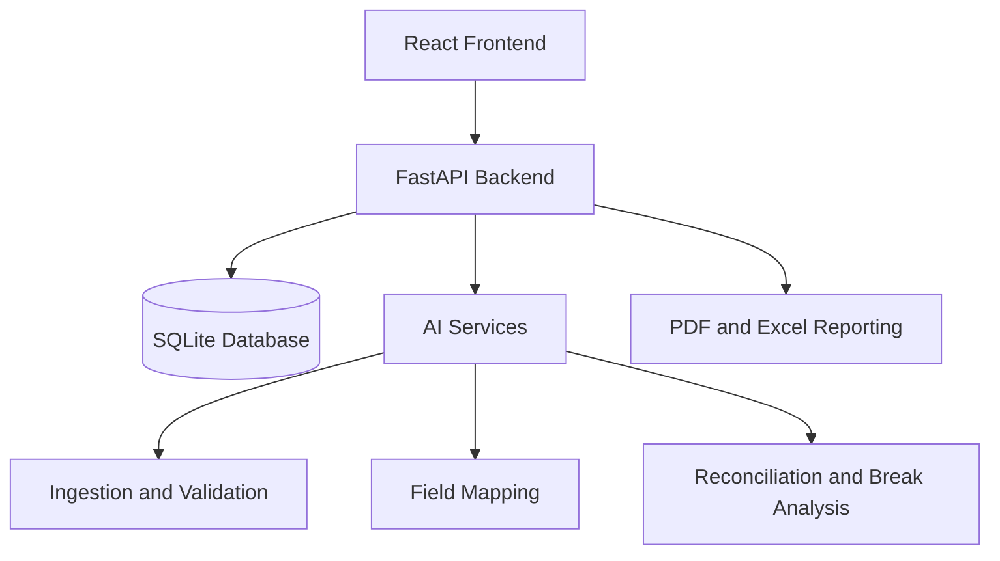

# Unizero Architecture

## Runtime Services

- Frontend: Vite on `127.0.0.1:5173`.
- Backend: FastAPI/Uvicorn on `127.0.0.1:8000`.
- AI service: FastAPI/Uvicorn on `127.0.0.1:8001`.
- Database: SQLite configured by `DATABASE_URL`.

## Current Data Flow

1. The investigator creates a workflow through `POST /api/workflows`.
2. The browser uploads local files through `POST /api/data-sources/upload` and registers remote paths through `POST /api/data-sources`.
3. The browser sends the source to AI ingestion through `/ingestion/start` or `/ingestion/upload`.
4. The returned AI session ID is linked to the backend data-source record.
5. Clean sessions or human-approved review sessions can create an AI mapping session.
6. AI break analysis is currently mirrored through the backend AI bridge when that route is used.
7. Investigations, approvals, audit logs, and reports are exposed by backend routes, but the complete persistent run linkage still requires integration work.

## Persistence

Backend tables include users, workflows, data sources, field mappings, reconciliation runs/results, breaks, investigations, approvals, and audit logs. AI ingestion and mapping session internals remain in-memory in the current AI service process.
