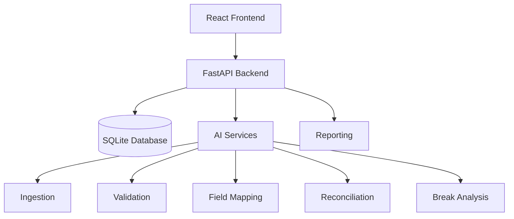

# Unizero — FINAL MVP INTEGRATION, REPAIR & RUN TASK

## ROLE

Act as a senior full-stack engineer, backend engineer, data engineer, AI integration engineer, QA engineer, and solution architect.

You are working on an EXISTING Unizero implementation.

Your task is NOT to rebuild the project.

Your task is to take the existing implementation created by the team, identify the gaps, integrate the existing components, remove hardcoded/mock behavior, make the complete workflow executable, test it end-to-end, and document everything.

The ultimate objective is:

> Make the existing Unizero project run as a real, dynamic, end-to-end MVP that can demonstrate the complete reconciliation lifecycle using actual user-provided data.

---

# 0. NON-NEGOTIABLE REQUIREMENT — CLEAN, ERROR-FREE EXECUTION

The application must run completely and correctly from a clean environment.

"Implemented" does NOT mean the feature exists in the code.

A feature is considered implemented only when it has been executed successfully through the actual application flow without:

- runtime errors
- unhandled exceptions
- frontend console errors
- frontend console warnings
- backend traceback/errors
- API 4xx/5xx errors during the normal successful flow
- AI-service errors
- database errors
- broken network requests
- missing environment variables
- import errors
- dependency errors
- CORS errors
- routing errors
- authentication errors
- invalid state transitions
- React warnings
- React key warnings
- deprecated API warnings that affect execution
- Streamlit/runtime warnings where applicable
- broken report generation
- broken file downloads
- silent failures
- placeholder/mock responses
- "success" UI messages when the underlying operation failed

The final system must be demonstrated as a clean, working application.

---

# CLEAN EXECUTION PRINCIPLE

Do NOT stop when the application starts successfully.

The following must ALL work:

```text
Environment Setup
      ↓
Dependency Installation
      ↓
Database Initialization
      ↓
Backend Startup
      ↓
AI Service Startup
      ↓
Frontend Startup
      ↓
Frontend ↔ Backend
      ↓
Backend ↔ Database
      ↓
Backend ↔ AI Services
      ↓
Authentication
      ↓
Workflow Creation
      ↓
Data Upload
      ↓
Validation
      ↓
Mapping
      ↓
Manual Override
      ↓
Reconciliation
      ↓
Break Detection
      ↓
Investigation
      ↓
Approval
      ↓
Audit
      ↓
Report Generation
      ↓
Report Download
```

There must be no broken step in this chain.

---

# 1. SOURCE OF TRUTH

Use these as the source of truth:

1. Unizero requirements PDF:
   `CHE UC 3 Unizero vfinal8cbd48f.pdf`

2. Existing implementation:
   - `backend/`
   - `ai-services/`
   - `frontend/`
   - existing tests
   - existing configuration
   - existing sample datasets

3. Team status report:
   `TEAM_STATUS_REPORT.md`

The team status report already identifies the current implementation and gaps.

DO NOT ignore existing work.

DO NOT rebuild functionality that already exists unless it is broken or cannot be integrated.

---

# 2. CURRENT PROJECT STATE

The project already contains substantial implementation.

Existing components include:

### Backend

- authentication
- password hashing
- JWT
- roles
- workflows
- data sources
- mappings
- reconciliation runs
- breaks
- approvals
- audit models
- FastAPI routers
- SQLite support
- reporting endpoints

Important existing locations include:

```text
backend/main.py
backend/auth/
backend/workflows/
backend/database/
backend/breaks/
backend/reports/
```

### AI Services

Existing functionality includes:

```text
ai-services/ingestion/
ai-services/field_mapping/
ai-services/reconciliation/
ai-services/break_management/
ai-services/mapping.py
```

This already contains substantial logic for:

- ingestion
- validation
- human review gate
- field mapping
- similarity
- manual override
- mapping validation
- reconciliation
- break analysis
- RCA concepts

### Frontend

Existing React application includes:

```text
frontend/src/App.jsx
frontend/src/pages/auth/
frontend/src/pages/investigator/
frontend/src/pages/approver/
```

including:

- Login
- Investigator dashboard
- Mapping
- Breaks
- Investigation
- Approver dashboard

### Reporting

Existing backend report generation exists for:

- Excel
- PDF

---

# 3. CRITICAL OBJECTIVE

Convert the current repository from:

```text
Separate prototype modules
+
mock frontend data
+
demo credentials
+
partially connected services
```

into:

```text
ONE REAL APPLICATION
```

with this complete flow:

```text
Initial Setup
      ↓
Create User
      ↓
Login
      ↓
Workflow Dashboard
      ↓
Create Workflow
      ↓
Upload Dataset 1
      ↓
Upload Dataset 2
      ↓
Data Quality Validation
      ↓
Human Go-Ahead
      ↓
Dynamic Field Detection
      ↓
AI-Assisted Field Mapping
      ↓
Manual Mapping Override
      ↓
Mapping Validation
      ↓
Reconciliation Configuration
      ↓
Run Reconciliation
      ↓
Match / Unmatch
      ↓
Break Detection
      ↓
Root Cause Analysis
      ↓
Investigator Investigation
      ↓
Investigator Justification
      ↓
Approver Review
      ↓
Approve / Reject
      ↓
Audit Trail
      ↓
Report Generation
      ↓
Download Report
      ↓
Workflow Run History
```

This entire lifecycle must work with real data.

---

# 4. FIRST ACTION — AUDIT BEFORE CODING

DO NOT immediately start modifying files.

First inspect the repository.

Determine:

```text
- how frontend starts
- how backend starts
- how AI service starts
- database configuration
- API URLs
- CORS configuration
- authentication flow
- existing API endpoints
- frontend API client
- database models
- database migrations/setup
- existing mapping flow
- existing ingestion flow
- reconciliation implementation
- break implementation
- approval implementation
- reporting implementation
- existing tests
- existing environment configuration
```

Create:

```text
docs/IMPLEMENTATION_GAP_ANALYSIS.md
```

with:

| Area | Existing Implementation | Gap | Action |
|---|---|---|---|
| Auth | Existing | Demo credentials | Remove |
| Workflow | Existing | Integration | Connect |
| Ingestion | Existing | Frontend integration | Connect |
| Mapping | Existing | End-to-end integration | Connect |
| Reconciliation | Existing | Lifecycle integration | Connect |
| Breaks | Existing | Persistence/UI | Connect |
| Approval | Existing | End-to-end validation | Connect |
| Reports | Existing | Real execution data | Connect |
| Dashboard | Existing | Mock values | Replace |
| Documentation | Missing | Required | Create |

Do not duplicate this logic elsewhere.

---

# 5. ABSOLUTE RULE — PRESERVE EXISTING WORK

Before creating new modules:

Search for existing functionality.

If something already exists:

```text
REUSE → FIX → INTEGRATE
```

Do NOT:

```text
IGNORE → REWRITE → DUPLICATE
```

The existing AI mapping implementation should be reused.

The existing ingestion implementation should be reused.

The existing reconciliation implementation should be reused.

The existing break/RCA implementation should be reused.

The existing report implementation should be reused.

---

# 6. NO HARDCODING

This is a strict acceptance criterion.

Remove ALL hardcoded:

- usernames
- passwords
- demo credentials
- workflows
- workflow metrics
- transaction IDs
- amounts
- breaks
- approvals
- audit records
- dashboard statistics
- reconciliation results
- field mappings
- dataset-specific logic

Search the entire repository for:

```text
admin@Unizero.com
Admin@123
investigator@Unizero.com
Investigator@123
approver@Unizero.com
Approver@123
```

and all mock/demo credential definitions.

Remove them.

Also inspect:

```text
frontend/src/data/mockData.js
frontend/src/pages/investigator/Dashboard.jsx
frontend/src/pages/approver/Dashboard.jsx
backend/main.py
```

and any other file containing static demo data.

---

# 7. AUTHENTICATION

There must be NO default credentials.

Fresh database behavior:

```text
No users
   ↓
Initial Setup
   ↓
Create first user
   ↓
Select role
   ↓
Password hashing
   ↓
Persist
   ↓
Login
```

Supported roles:

```text
Investigator
Approver
```

Use existing authentication implementation if it is sound.

Do not replace working password hashing unnecessarily.

Credentials must never appear in source code.

---

# 8. SECRET MANAGEMENT

Find and remove all hardcoded secrets.

Especially inspect:

```text
backend/config/settings.py
```

Do not allow:

```python
jwt_secret = "CHANGE_THIS_SECRET"
```

Use environment configuration.

Create:

```text
.env.example
```

Example:

```env
DATABASE_URL=sqlite:///./Unizero.db
JWT_SECRET=
AI_SERVICE_URL=http://localhost:<configured-port>
```

Do not put actual secrets in `.env.example`.

Ensure:

```text
.env
```

is gitignored.

Generate/use a real runtime secret during local setup.

---

# 9. BACKEND ↔ AI SERVICE INTEGRATION

Identify the actual AI-service APIs.

Document:

```text
Endpoint
HTTP method
Request schema
Response schema
Error behavior
```

Then connect:

```text
Backend
   ↓
AI Service
```

for:

### Ingestion

Backend receives workflow/input request.

AI service performs:

- file loading
- profiling
- validation
- schema extraction

Return result.

Persist relevant metadata.

---

# 10. HUMAN DATA QUALITY GATE

The existing AI-service validation gate must become a real application flow.

Required behavior:

```text
Upload
 ↓
Validate
 ↓
Issues found?
 ├── NO → Continue
 │
 └── YES
       ↓
     Show issues
       ↓
     User review
       ↓
     Go-Ahead / correction
       ↓
     Continue
```

The user must explicitly approve continuation when required.

Persist the decision.

Audit it.

---

# 11. DYNAMIC FIELD MAPPING

Reuse the existing mapping engine.

Do not create hardcoded mappings.

The system must dynamically inspect uploaded datasets.

Mapping should use the existing implementation's:

- normalization
- similarity
- datatype compatibility
- value similarity where available

Maintain classifications:

```text
Common
Potential
Uncommon
```

Thresholds should be configurable.

---

# 12. FRONTEND MAPPING INTEGRATION

The existing React mapping screen must consume real backend/AI-service results.

It must NOT contain:

```text
const mappings = [...]
```

or equivalent static mappings.

Flow:

```text
Upload
 ↓
Backend
 ↓
AI mapping service
 ↓
Mapping response
 ↓
React mapping screen
 ↓
User override
 ↓
Backend
 ↓
Persist mapping
```

---

# 13. MANUAL OVERRIDE

Use existing manual mapping implementation.

Support:

- selecting source field
- selecting target field
- overriding AI recommendation
- clearing mapping
- saving mapping
- validation

If the backend already supports this, expose it correctly through the frontend instead of rebuilding the service.

---

# 14. MAPPING VALIDATION

Before reconciliation:

Validate:

- duplicate mappings
- missing required mappings
- datatype incompatibility
- invalid key
- invalid amount field

Block execution on critical mapping errors.

Show actionable UI messages.

---

# 15. RECONCILIATION

Connect the existing reconciliation engine to the actual workflow.

The user must configure:

```text
Reconciliation key
Amount field(s)
Tolerance
```

Do NOT assume field names.

Example:

Dataset A could have:

```text
Transaction_ID
Settlement_Value
```

Dataset B could have:

```text
Reference
Amount
```

and the system must operate dynamically.

The reconciliation result must be calculated from uploaded data.

---

# 16. RECONCILIATION PERSISTENCE

Every execution must create a real reconciliation run.

Persist:

```text
workflow_id
run_id
run_number
status
started_at
completed_at
total_records
matched_records
break_count
match_rate
```

Do not overwrite previous runs.

---

# 17. BREAK MANAGEMENT

Connect the existing break implementation.

Breaks must be generated from actual reconciliation results.

Persist:

```text
break_id
run_id
business_key
source values
variance
break type
root cause
status
```

Do not hardcode break IDs.

---

# 18. ROOT CAUSE ANALYSIS

Reuse existing RCA logic.

For MVP, explainable rule-based RCA is acceptable.

Example:

```text
Missing in Input 1
→ Key exists in Input 2 but not Input 1
```

or:

```text
Amount mismatch
→ Same business key exists in both sources but numeric values differ
```

The explanation must be generated from the actual break.

Do not create fake AI explanations.

---

# 19. INVESTIGATOR FLOW

Investigator must be able to:

```text
View breaks
 ↓
Open break
 ↓
Review RCA
 ↓
Enter justification
 ↓
Submit
```

Persist the justification.

Create audit event.

---

# 20. APPROVER FLOW

Approver must see actual submitted breaks.

Approver must be able to:

```text
Review
 ↓
Approve
OR
Reject / Return
```

Persist:

```text
decision
approver
timestamp
note
```

Investigator must not automatically approve their own submission.

---

# 21. DYNAMIC DASHBOARDS

Remove every static dashboard number.

For example:

```text
38 approvals
4 pending
42 total
```

must NOT exist as static frontend values.

Calculate from backend/database.

Dashboard must retrieve:

```text
workflow count
run count
break count
approval count
pending count
completed count
```

from real APIs.

---

# 22. WORKFLOW DASHBOARD

Existing workflow dashboard must use real backend data.

Required:

```text
Create
View
Edit
Delete
Run
History
Report
```

where supported by existing backend.

Workflow cards must come from API.

---

# 23. REPORTING

Reuse:

```text
backend/reports/
```

Do not rebuild if existing report generation works.

Verify reports contain actual:

```text
workflow
run
input information
mapping
summary
matched records
breaks
variance
RCA
investigation
approval
audit
```

Test both:

```text
Excel
PDF
```

if both endpoints are already implemented.

---

# 24. AUDIT

Connect the existing audit model/service.

Audit real events:

```text
USER_CREATED
LOGIN
WORKFLOW_CREATED
DATA_UPLOADED
DATA_VALIDATED
GO_AHEAD
MAPPING_GENERATED
MAPPING_UPDATED
RECONCILIATION_STARTED
RECONCILIATION_COMPLETED
BREAK_CREATED
INVESTIGATION_SUBMITTED
APPROVAL_RECORDED
REPORT_GENERATED
```

Do not insert fake audit rows.

---

# 25. ERROR HANDLING

Test:

- invalid credentials
- expired token
- unauthorized role
- missing workflow
- invalid file
- empty file
- malformed CSV
- malformed Excel
- missing mapping
- duplicate mapping
- incompatible datatype
- invalid reconciliation configuration
- AI service unavailable
- backend unavailable
- database failure

Provide meaningful errors.

---

# 26. FRONTEND API INTEGRATION

Audit every frontend page.

For each page ask:

```text
Where does this data come from?
```

If the answer is:

```text
mockData.js
initialWorkflows
static array
hardcoded constant
```

replace it with API/database data.

Create a clear API client layer if one doesn't exist.

Centralize:

```text
auth
workflows
uploads
mapping
reconciliation
breaks
approvals
reports
audit
```

---

# 27. END-TO-END TEST

Create a real end-to-end smoke test.

The test must execute:

```text
Create user
 ↓
Login
 ↓
Create workflow
 ↓
Upload dataset A
 ↓
Upload dataset B
 ↓
Validation
 ↓
Go-Ahead
 ↓
Mapping
 ↓
Override
 ↓
Reconciliation
 ↓
Break detection
 ↓
Investigation
 ↓
Approval
 ↓
Report
```

Do not mock internal application services for this test.

Use synthetic datasets.

---

# 28. DYNAMIC DATA TEST

This is a critical acceptance test.

Run the application with Dataset A.

Then completely replace the datasets with Dataset B containing:

- different column names
- different records
- different amounts
- different number of records
- different mappings

The system must still work without source-code changes.

If it fails, fix the underlying hardcoded assumption.

---

# 29. CLEAN START TEST

Test from a clean environment.

Delete the local development database.

Start the application.

Expected:

```text
No users
 ↓
Create first user
 ↓
Login
 ↓
Create workflow
```

There must be no default credentials.

---

# 30. NO MOCK DATA TEST

Search frontend and backend for:

```text
mock
demo
sample user
initialWorkflows
hardcoded
TODO
fake
```

Review each occurrence.

Sample datasets are allowed only as external demo files.

They must never drive application logic.

---

# 31. DOCUMENTATION

After implementation, create:

```text
docs/
├── IMPLEMENTATION.md
├── ARCHITECTURE.md
├── REQUIREMENTS_MAPPING.md
├── TESTING.md
├── DEMO_GUIDE.md
├── LIMITATIONS.md
├── IMPLEMENTATION_GAP_ANALYSIS.md
└── FINAL_REPORT.md
```

---

# 32. IMPLEMENTATION.md

Document:

- what already existed
- what was changed
- what was integrated
- what was fixed
- backend changes
- frontend changes
- AI-service changes
- database changes
- authentication
- security
- configuration
- reconciliation
- breaks
- approval
- reporting
- audit

Include file paths.

---

# 33. ARCHITECTURE.md

Document the actual architecture.

Include Mermaid diagrams.

At minimum:



Also document actual API/data flows.

---

# 34. REQUIREMENTS_MAPPING.md

Create:

| Requirement | Existing | Changed | Final Status | Evidence |
|---|---|---|---|---|

Use:

```text
Implemented
Partially Implemented
Future
```

Do not claim features are implemented without testing.

---

# 35. TESTING.md

Record actual tests.

For every test:

```text
Test
Expected
Actual
Status
Evidence
```

Do not write "PASS" unless you actually executed it.

---

# 36. DEMO_GUIDE.md

Provide exact evaluator instructions:

```text
1. Start services
2. Create user
3. Login
4. Create workflow
5. Upload datasets
6. Validate
7. Go-Ahead
8. Review mapping
9. Override mapping
10. Run reconciliation
11. Review breaks
12. Investigate
13. Approve
14. Review audit
15. Generate report
```

---

# 37. LIMITATIONS.md

Clearly separate:

### Fully implemented

### Partially implemented

### Not implemented

### Future enterprise capabilities

Do not exaggerate the MVP.

---

# 38. FINAL_REPORT.md

The final report must contain:

## Executive Summary

## Existing Team Work Reused

## Changes Made

## End-to-End Workflow

## Architecture

## Technology Stack

## Database

## Authentication

## Data Ingestion

## Validation

## Field Mapping

## Reconciliation

## Break Management

## RCA

## Investigator

## Approver

## Audit

## Reporting

## Testing

## Security

## Requirements Coverage

## Remaining Limitations

## Future Enhancements

## Run Instructions

---

# 39. FINAL ACCEPTANCE CRITERIA

Do NOT declare the task complete until ALL applicable items below have been tested.

### Startup

[ ] Backend starts

[ ] AI service starts

[ ] Frontend starts

[ ] Database initializes

[ ] Services communicate

### Authentication

[ ] No default credentials

[ ] First-user setup works

[ ] Passwords are hashed

[ ] Login works

[ ] Invalid login rejected

[ ] Roles work

### Workflow

[ ] Create workflow

[ ] View workflows

[ ] Edit workflow

[ ] Delete workflow

[ ] Persist workflow

### Ingestion

[ ] CSV works

[ ] Excel works

[ ] Actual uploaded files are processed

### Validation

[ ] Null detection

[ ] Duplicate detection

[ ] Data-type inspection

[ ] Human Go-Ahead

### Mapping

[ ] Dynamic field discovery

[ ] Automated mapping

[ ] Similarity classification

[ ] Manual override

[ ] Mapping validation

### Reconciliation

[ ] Dynamic key

[ ] Dynamic amount field

[ ] Dynamic tolerance

[ ] Matching

[ ] Variance

[ ] Break generation

### Breaks

[ ] Break persistence

[ ] Dynamic RCA

[ ] Investigation

### Approval

[ ] Investigator submits

[ ] Approver reviews

[ ] Approver approves/rejects

[ ] Decision persists

### Audit

[ ] Real audit events

[ ] Audit persists

### Reports

[ ] Excel report

[ ] PDF report if supported

[ ] Actual execution data in reports

### Dynamic behavior

[ ] No mock dashboard values

[ ] No hardcoded credentials

[ ] No hardcoded mappings

[ ] No hardcoded reconciliation results

[ ] Different datasets work without code changes

### Documentation

[ ] README

[ ] IMPLEMENTATION.md

[ ] ARCHITECTURE.md

[ ] REQUIREMENTS_MAPPING.md

[ ] TESTING.md

[ ] DEMO_GUIDE.md

[ ] LIMITATIONS.md

[ ] IMPLEMENTATION_GAP_ANALYSIS.md

[ ] FINAL_REPORT.md

---

# 40. IMPORTANT EXECUTION STRATEGY

You have limited time.

Therefore:

## DO NOT

- rewrite the entire project
- migrate frameworks
- introduce unnecessary infrastructure
- replace the existing AI mapping engine
- replace the existing backend architecture
- create a second application
- create mock screens
- add unnecessary animations
- implement advanced features before the core workflow works

## DO

- inspect existing code
- reuse existing modules
- connect existing APIs
- remove mock data
- fix integration
- persist real state
- test actual workflows
- fix failures
- document actual implementation

Priority is:

```text
RUNNING SYSTEM
      ↓
REAL DATA FLOW
      ↓
PERSISTENCE
      ↓
END-TO-END WORKFLOW
      ↓
SECURITY
      ↓
TESTING
      ↓
DOCUMENTATION
      ↓
POLISH
```

---

# 41. FINAL RESPONSE REQUIRED FROM THE AGENT

After completing the implementation, return:

```text
Unizero FINAL IMPLEMENTATION STATUS

Application:
RUNNING / NOT RUNNING

Backend:
PASS / FAIL

AI Services:
PASS / FAIL

Frontend:
PASS / FAIL

Database:
PASS / FAIL

Authentication:
PASS / FAIL

Workflow:
PASS / FAIL

Data Ingestion:
PASS / FAIL

Validation:
PASS / FAIL

Field Mapping:
PASS / FAIL

Reconciliation:
PASS / FAIL

Break Management:
PASS / FAIL

RCA:
PASS / FAIL

Investigator:
PASS / FAIL

Approver:
PASS / FAIL

Audit:
PASS / FAIL

Reports:
PASS / FAIL

End-to-End Test:
PASS / FAIL

Dynamic Dataset Test:
PASS / FAIL

Hardcoding Audit:
PASS / FAIL

Documentation:
PASS / FAIL
```

Then provide:

```text
Files Created
Files Modified
Database Changes
API Changes
Frontend Changes
AI Service Changes
Tests Executed
Known Issues
Remaining Limitations
Exact Run Commands
Exact Demo Steps
```

Most importantly:

**Do not claim that Unizero is complete merely because individual modules exist. The final acceptance criterion is a successful real end-to-end execution from user creation/login through report generation using an uploaded dataset.**

---

## Your actual target for the remaining time

Based on your team's status, I would **not spend the remaining time implementing advanced AI features**. The report says the existing code already has substantial ingestion, mapping, reconciliation, break and reporting foundations.

Your critical path is:

```text
                 CURRENT STATE
                      │
       ┌──────────────┴──────────────┐
       │                             │
 Existing Backend              Existing AI Services
       │                             │
       └──────────────┬──────────────┘
                      ↓
              INTEGRATION
                      ↓
              Remove Mocks
                      ↓
             Dynamic Frontend
                      ↓
          Real DB Persistence
                      ↓
         Complete Reconciliation
                      ↓
           Investigator/Approver
                      ↓
              Real Reports
                      ↓
             End-to-End Test
                      ↓
             DOCUMENT EVERYTHING
```

The team status explicitly characterizes the current code as a **strong prototype/partial implementation**, not a complete MVP, primarily because the full lifecycle hasn't been validated as one connected flow.

So **don't tell your agent "build Unizero."** Tell it:

> **"Take the existing Unizero implementation, preserve the work, integrate everything, remove hardcoding/mock behavior, make one complete real workflow run, test it, and document it."**

That distinction is important. It prevents the agent from wasting your remaining time rebuilding the parts your team has already completed.
Yes. Then make **zero-errors/zero-warnings at runtime and a clean end-to-end execution** a hard acceptance criterion for the agent—not just “features implemented.”

Add this section to the previous agent prompt, preferably **near the beginning and again in the acceptance criteria**:

```md
# 0. NON-NEGOTIABLE REQUIREMENT — CLEAN, ERROR-FREE EXECUTION

The application must run completely and correctly from a clean environment.

"Implemented" does NOT mean the feature exists in the code.

A feature is considered implemented only when it has been executed successfully through the actual application flow without:

- runtime errors
- unhandled exceptions
- frontend console errors
- frontend console warnings
- backend traceback/errors
- API 4xx/5xx errors during the normal successful flow
- AI-service errors
- database errors
- broken network requests
- missing environment variables
- import errors
- dependency errors
- CORS errors
- routing errors
- authentication errors
- invalid state transitions
- React warnings
- React key warnings
- deprecated API warnings that affect execution
- Streamlit/runtime warnings where applicable
- broken report generation
- broken file downloads
- silent failures
- placeholder/mock responses
- "success" UI messages when the underlying operation failed

The final system must be demonstrated as a clean, working application.

---

# CLEAN EXECUTION PRINCIPLE

Do NOT stop when the application starts successfully.

The following must ALL work:

```text
Environment Setup
      ↓
Dependency Installation
      ↓
Database Initialization
      ↓
Backend Startup
      ↓
AI Service Startup
      ↓
Frontend Startup
      ↓
Frontend ↔ Backend
      ↓
Backend ↔ Database
      ↓
Backend ↔ AI Services
      ↓
Authentication
      ↓
Workflow Creation
      ↓
Data Upload
      ↓
Validation
      ↓
Mapping
      ↓
Manual Override
      ↓
Reconciliation
      ↓
Break Detection
      ↓
Investigation
      ↓
Approval
      ↓
Audit
      ↓
Report Generation
      ↓
Report Download
```

There must be no broken step in this chain.

---

# 1. CLEAN ENVIRONMENT TEST

Before final completion, simulate a fresh installation.

Do not rely on an already-working developer machine.

Perform:

```text
1. Remove generated database
2. Remove cached build artifacts where appropriate
3. Create fresh virtual environment
4. Install dependencies
5. Configure environment variables
6. Initialize database
7. Start AI service
8. Start backend
9. Start frontend
```

Record the exact commands.

If the project requires Node:

```bash
npm install
npm run build
```

If the backend requires Python:

```bash
python -m venv .venv
pip install -r requirements.txt
```

Use the project's actual commands after inspecting the repository.

Do not invent commands.

---

# 2. DEPENDENCY VALIDATION

Check:

- Python version
- Node version
- npm version
- package versions
- Python dependencies
- frontend dependencies
- missing packages
- incompatible packages
- lock files

Run the project's actual build/install commands.

Fix all dependency failures.

Do not merely suppress dependency warnings.

If a dependency is unused, remove it only if safe.

---

# 3. BACKEND CLEAN START

Start the backend from a clean state.

Verify:

```text
Startup succeeds
Database connection succeeds
Application health endpoint succeeds
OpenAPI loads
No startup traceback
No configuration errors
No missing environment variables
No unexpected warnings
```

Check the terminal output.

Do not declare success merely because the process remains running.

---

# 4. AI SERVICE CLEAN START

Start the AI service independently.

Verify:

```text
AI service starts
Health endpoint works
Ingestion endpoint works
Validation endpoint works
Mapping endpoint works
Reconciliation endpoint works
Break/RCA endpoint works
```

where those endpoints exist in the current implementation.

Every endpoint used by the frontend/backend must be tested.

---

# 5. FRONTEND CLEAN START

Start the React frontend.

Verify:

```text
Build succeeds
Development server starts
Application loads
No blank page
No React runtime errors
No React warnings
No failed imports
No missing assets
No broken routes
```

Run the production build if supported:

```bash
npm run build
```

The build must complete successfully.

---

# 6. BROWSER CONSOLE VALIDATION

Use browser developer tools or an available browser automation tool.

Check:

### Console

There must be no:

```text
ERROR
WARN
Unhandled exception
Unhandled promise rejection
React warning
```

### Network

During the successful workflow there must be no unexpected:

```text
4xx
5xx
CORS errors
failed requests
404 API calls
500 API calls
```

A request that intentionally returns a validation error must be handled correctly and must not produce an unhandled application error.

---

# 7. COMPLETE END-TO-END TEST

Execute the real UI workflow.

Do NOT call internal functions directly as the only verification.

Perform:

```text
1. Open application
2. Create first user
3. Login
4. Create workflow
5. Upload dataset 1
6. Upload dataset 2
7. Wait for ingestion
8. Review data-quality results
9. Give Go-Ahead where required
10. Generate mappings
11. Review mappings
12. Override at least one mapping
13. Validate mapping
14. Configure reconciliation
15. Run reconciliation
16. View dashboard
17. Open a real break
18. Review RCA
19. Submit investigation
20. Login as Approver
21. Review submitted break
22. Approve or reject
23. Verify status changed
24. Open audit trail
25. Generate report
26. Download report
27. Open downloaded report
28. Verify report contains actual execution results
```

Every step must succeed.

---

# 8. DO NOT ACCEPT PARTIAL SUCCESS

For example:

If the UI displays:

```text
Reconciliation completed
```

but the backend returned:

```text
500 Internal Server Error
```

this is a FAILURE.

If the report button displays:

```text
Report generated
```

but the downloaded file is corrupted:

FAILURE.

If approval displays:

```text
Approved
```

but the database record remains pending:

FAILURE.

If the frontend shows a workflow that does not exist in the backend:

FAILURE.

If an API fails but the UI hides the error:

FAILURE.

Never hide errors to make the demo appear successful.

---

# 9. DATABASE CONSISTENCY VALIDATION

After completing the workflow, inspect the database.

Verify that the same workflow exists consistently across:

```text
Users
Workflows
Workflow inputs
Mappings
Reconciliation runs
Breaks
Investigations
Approvals
Audit records
Report metadata
```

Verify foreign-key relationships.

Verify that no orphan records are created.

Verify that restarting the application does not lose the workflow.

---

# 10. RESTART TEST

After successfully completing Unizerociliation:

```text
Stop frontend
Stop backend
Stop AI service

Restart everything
```

Then:

```text
Login
 ↓
Open workflow dashboard
 ↓
Existing workflow still exists
 ↓
Previous run still exists
 ↓
Breaks still exist
 ↓
Approval status still exists
 ↓
Audit trail still exists
 ↓
Report can still be generated/downloaded
```

If persisted data disappears after restart, fix it.

---

# 11. DYNAMIC DATA TEST

Create a second completely different synthetic dataset.

Change:

- field names
- number of records
- keys
- amounts
- values
- matching relationships

Do NOT modify source code.

Run the complete reconciliation again.

The application must still work.

This is mandatory proof that the system is dynamic rather than dataset-hardcoded.

---

# 12. NEGATIVE TESTING

Test invalid scenarios deliberately.

### Authentication

```text
Invalid password
Invalid username
Inactive user
Unauthorized role
```

### Upload

```text
Empty file
Malformed CSV
Malformed Excel
Unsupported format
Missing required data
```

### Mapping

```text
No valid mapping
Duplicate mapping
Datatype mismatch
Missing reconciliation key
```

### Reconciliation

```text
Empty dataset
Duplicate keys
Missing amount
Invalid numeric values
```

### Services

```text
AI service unavailable
Backend unavailable
Database unavailable
```

The application must handle these gracefully.

No raw stack traces should be shown to normal users.

---

# 13. ERROR HANDLING RULE

Every error must have BOTH:

### Technical behavior

```text
Log the actual error
Preserve useful diagnostic information
Return appropriate HTTP/application error
```

### User behavior

```text
Show understandable message
Tell user what went wrong
Tell user what action they can take
```

Never use:

```python
except:
    pass
```

Never silently swallow errors.

Never return fake success.

---

# 14. WARNING CLEANUP

Before final completion, inspect:

### Backend terminal

Remove/fix:

- startup warnings
- deprecation warnings
- configuration warnings
- database warnings
- unhandled exceptions

### Frontend terminal

Remove/fix:

- compilation warnings
- ESLint warnings where applicable
- dependency warnings affecting runtime

### Browser console

Remove/fix:

- React warnings
- key warnings
- failed network requests
- CORS warnings
- unhandled promise rejections

### Build

Run the actual production build.

Do not simply ignore warnings.

If a warning is produced by an unavoidable third-party dependency and does not originate from the project, document it explicitly rather than hiding it.

---

# 15. API CONTRACT VALIDATION

For every frontend API call:

Verify:

```text
Frontend request
       ↓
Correct URL
       ↓
Correct HTTP method
       ↓
Correct authentication
       ↓
Correct request body
       ↓
Backend validation
       ↓
AI service/database operation
       ↓
Correct response
       ↓
Frontend state update
```

Check for:

- incorrect endpoint names
- mismatched JSON fields
- incorrect IDs
- wrong HTTP methods
- missing headers
- incorrect response parsing
- stale API contracts

Fix the source of the mismatch rather than adding frontend hacks.

---

# 16. CORS VALIDATION

The frontend must communicate with the backend without CORS errors.

Configure CORS from environment/configuration where appropriate.

Do not use unsafe wildcard configuration in a way that conflicts with the intended security model.

Verify actual browser requests.

---

# 17. AUTHENTICATION FLOW VALIDATION

Test:

```text
Create user
 ↓
Password stored hashed
 ↓
Login
 ↓
JWT/session generated
 ↓
Authenticated API call
 ↓
Role authorization
```

Verify:

```text
Investigator cannot perform unauthorized Approver-only operations.

Approver cannot access operations that require Investigator ownership where the role model forbids it.
```

---

# 18. REPORT VALIDATION

For every generated report:

1. Generate it from the UI.
2. Download it.
3. Verify the file exists.
4. Open it programmatically if possible.
5. Verify worksheets/pages exist.
6. Verify actual workflow data is present.
7. Verify no placeholder values exist.
8. Verify no corrupted output.

For Excel verify:

```text
Summary
Mapping
Reconciliation
Breaks
Audit
```

where those are supported by the existing implementation.

For PDF verify:

- opens successfully
- correct workflow
- correct run
- correct reconciliation summary
- correct breaks
- correct RCA

---

# 19. HARD-CODE AUDIT

Before completion search the entire repository.

Search for:

```text
admin@Unizero.com
Admin@123
investigator@Unizero.com
Investigator@123
approver@Unizero.com
Approver@123
initialWorkflows
mockData
mockUsers
demoUsers
demo credentials
CHANGE_THIS_SECRET
```

Also inspect for:

```text
hardcoded workflow IDs
hardcoded transaction IDs
hardcoded metrics
hardcoded break IDs
hardcoded approval counts
hardcoded reconciliation results
```

Every occurrence must be reviewed.

Do not blindly delete legitimate test fixtures.

Clearly separate:

```text
Application logic
Test fixtures
External sample datasets
```

Test fixtures may contain synthetic credentials/data if they are explicitly isolated from runtime configuration and documented.

---

# 20. FINAL QUALITY GATE

The agent must not say:

```text
"Implementation complete"
```

until ALL of these are true:

[ ] Clean installation succeeds

[ ] Dependencies install successfully

[ ] Database initializes

[ ] Backend starts cleanly

[ ] AI service starts cleanly

[ ] Frontend builds successfully

[ ] Frontend starts successfully

[ ] Browser loads successfully

[ ] No application runtime errors

[ ] No unexpected browser console errors

[ ] No unexpected browser console warnings

[ ] No unexpected backend errors

[ ] No unexpected AI-service errors

[ ] No failed API calls during successful flow

[ ] Authentication works

[ ] Workflow creation works

[ ] Dataset upload works

[ ] Data validation works

[ ] Human Go-Ahead works

[ ] Mapping works

[ ] Manual override works

[ ] Mapping validation works

[ ] Reconciliation works

[ ] Break detection works

[ ] RCA works

[ ] Investigator works

[ ] Approver works

[ ] Audit works

[ ] Report generation works

[ ] Report download works

[ ] Downloaded report opens correctly

[ ] Data persists after restart

[ ] Different datasets work without code changes

[ ] No hardcoded credentials

[ ] No fake runtime data

[ ] No fake success states

[ ] Documentation is complete

---

# 21. REQUIRED FINAL TEST REPORT

Create:

`docs/FINAL_VALIDATION_REPORT.md`

Include:

## Environment

```text
OS:
Python:
Node:
npm:
Database:
Frontend:
Backend:
AI Service:
```

## Startup Validation

| Component | Command | Result | Errors | Warnings |
|---|---|---|---|---|
| Database | ... | PASS/FAIL | ... | ... |
| AI Service | ... | PASS/FAIL | ... | ... |
| Backend | ... | PASS/FAIL | ... | ... |
| Frontend | ... | PASS/FAIL | ... | ... |

## End-to-End Validation

| Step | Result | Evidence |
|---|---|---|
| Create user | PASS/FAIL | ... |
| Login | PASS/FAIL | ... |
| Create workflow | PASS/FAIL | ... |
| Upload | PASS/FAIL | ... |
| Validation | PASS/FAIL | ... |
| Mapping | PASS/FAIL | ... |
| Override | PASS/FAIL | ... |
| Reconciliation | PASS/FAIL | ... |
| Breaks | PASS/FAIL | ... |
| RCA | PASS/FAIL | ... |
| Investigation | PASS/FAIL | ... |
| Approval | PASS/FAIL | ... |
| Audit | PASS/FAIL | ... |
| Report | PASS/FAIL | ... |

## Negative Testing

Record actual results.

## Dynamic Dataset Test

Record actual results.

## Restart/Persistence Test

Record actual results.

## Browser Console

Record actual errors/warnings.

## Backend Logs

Record actual errors/warnings.

## Known Third-Party Warnings

Only list warnings that are genuinely unavoidable and external to the project.

## Final Status

Only use:

```text
READY
```

if the complete application was actually tested successfully.

Otherwise use:

```text
NOT READY
```

and explicitly list what failed.

---

# 22. MOST IMPORTANT RULE

Do not optimize for "looks like it works."

Optimize for:

```text
IT ACTUALLY WORKS.
```

Do not hide errors.

Do not suppress warnings without understanding them.

Do not mock failed API calls.

Do not replace broken functionality with static data.

Do not mark tests as passed without running them.

Do not claim the application is ready without executing the complete workflow.

The final objective is a **clean, reproducible, error-free and warning-free end-to-end Unizero MVP execution from a fresh environment.**
```

## For your current team code specifically

The biggest risks identified in the team's report are **not missing features**. They are:

1. **Integration of the existing backend + AI services + frontend**
2. **Removal of hardcoded credentials/mock data**
3. **Real database-backed lifecycle**
4. **Dynamic frontend dashboards**
5. **Clean startup and API communication**
6. **Actual end-to-end validation**
7. **Documentation**

The report explicitly says the team already has substantial building blocks, but there is currently no verified single journey from user creation through report generation.

So your agent's first goal should be **"make the existing system run cleanly"**, not "add more features." After the first successful end-to-end run, fix every error/warning encountered, then perform the clean-environment and different-dataset tests.
